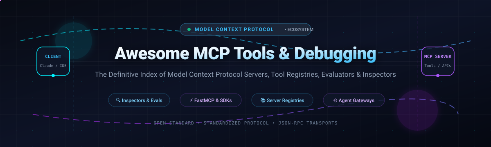

<p align="center">
  
</p>

# 🚀 Awesome Model Context Protocol (MCP) Tools & Debugging 🛠️⚡

<p align="center">
  <a href="https://github.com/ishandutta2007/Awesome-Awesome-Awesome"></a><a href="https://discord.gg/jc4xtF58Ve"></a>
  <a href="https://github.com/ishandutta2007/Awesome-Model-Context-Protocol-MCP-Tools-Debugging/stargazers"></a>
  <a href="https://github.com/ishandutta2007/Awesome-Model-Context-Protocol-MCP-Tools-Debugging/network/members"></a>
  <a href="https://github.com/ishandutta2007/Awesome-Model-Context-Protocol-MCP-Tools-Debugging/blob/main/LICENSE"></a>
  <a href="https://github.com/ishandutta2007"></a>
</p>

> 🌟 **The definitive, curated index of top Model Context Protocol (MCP) tools, hosted SaaS registries, debugging inspectors, agent evaluation platforms, and open-source frameworks.** MCP standardizes secure, bi-directional JSON-RPC connectivity between LLM clients (Claude Desktop, Cursor, AI IDEs, autonomous agents) and external developer tools, enterprise databases, and cloud APIs.

---

## 📑 Table of Contents
- [🌐 Sector Overview & Market Dynamics](#-sector-overview--market-dynamics)
- [☁️ SaaS & Hosted Platforms](#️-saas--hosted-platforms)
- [💻 Open-Source GitHub Projects](#-open-source-github-projects)
- [🛠️ How to Debug & Evaluate MCP Servers](#️-how-to-debug--evaluate-mcp-servers)
- [🤝 How to Contribute](#-how-to-contribute)
- [💖 Support & Sponsorship](#-support--sponsorship)
- [⚠️ Disclaimer](#️-disclaimer)
- [📈 Star History](#-star-history)

---

## 🌐 Sector Overview & Market Dynamics

The dedicated **AI agent infrastructure and tooling market is estimated at $2.3 billion in 2026** (projected to surge past **$14.3 billion by 2031**, accelerating at a **44.5% CAGR**), while the broader agentic AI orchestration ecosystem commands over **$11.8 billion**.

The Model Context Protocol (MCP) and tool-governance sector exhibits a **moderately fragmented, dual-tiered competitive dynamic**:
- **Enterprise Integration & API Gateways (Consolidating Tier)**: Scaled automation platforms (such as Zapier and Workday's Pipedream) alongside dedicated enterprise agent hubs (such as LangSmith / LangChain) drive standard compliance and monetize managed authentication, OAuth token vaults, enterprise SOC 2 compliance, and connector catalogs.
- **Agent Tool Registries, Runtimes & Protocol Tooling (Highly Fragmented Tier)**: Fast-moving AI startups (Composio, Toolhouse, Superface, Trigger.dev) compete dynamically against hyper-adopted open-source foundations (FastMCP, official MCP SDKs, and community-driven server registries). Because MCP is an open protocol standard, market adoption resists a single winner-take-all monopoly, favoring composable architectures where open-source development and debugging inspectors pair smoothly with specialized managed hosting layers.

---

## ☁️ SaaS & Hosted Platforms

The table below catalogs premier SaaS platforms and hosted tool registries for Model Context Protocol and agent execution, ranked in descending order by company scale (valuation or annual revenue run-rate):

| Platform | Category & Core Focus | Company Scale (Valuation / Revenue) | Starting Price (Paid Tier) | Free Tier Limit / Policy |
| :--- | :--- | :--- | :--- | :--- |
| **[Zapier MCP](https://zapier.com/)** | Enterprise workflow automation & natural-language MCP tool integration actions | **Valuation: ~$5.0B** *(ARR: ~$310M+)* | **$19.99 / month** *(Professional plan, billed annually)* | **Free forever plan**: 100 tasks/month, unlimited two-step Zaps (1 trigger + 1 action), basic Zapier Tables & Copilot. |
| **[LangChain Hub & LangSmith](https://smith.langchain.com/)** | Centralized prompt, tool, & agent component hub with enterprise observability & trace debugging | **Valuation: ~$1.25B** *(Series B)* | **$39.00 / user / month** *(Plus plan)* | **Free forever plan**: Developer tier includes 1 user seat, 5,000 base traces/month, and 14 days data retention. |
| **[Pipedream](https://pipedream.com/)** | Developer integration platform exposing APIs and serverless workflows as MCP tool endpoints | **Acquired by Workday** *(Parent Market Cap: ~$70B+; raised $20M prior)* | **$29.00 / month** *(Basic plan)* | **Free forever plan**: 100 compute credits/month, up to 3 active workflows, and 3 connected accounts (hard stop, no overage). |
| **[Composio](https://composio.dev/)** | Managed tool runtime, auth gateway, and production-grade tool registry for autonomous AI agents | **Funding: $29M raised** *(ARR: ~$1M+; Series A led by Lightspeed)* | **$29.00 / month** *(Pro plan with execution bundles)* | **Free forever plan**: Hobby tier includes 100,000 tool calls/month, 50,000 trigger events/month, 1M sandbox tokens, and unlimited connected accounts. |
| **[Trigger.dev](https://trigger.dev/)** | Cloud-hosted background jobs, durable execution engine, and MCP agent action runtime | **Funding: ~$20.3M raised** *(ARR: ~$2.7M)* | **$10.00 / month** *(Hobby tier with $10 monthly compute credits)* | **Free forever plan**: $5/month free compute credits, 20 concurrent runs, unlimited tasks, 5 team members, and 1-day log retention. |
| **[Apideck](https://apideck.com/)** | Unified API ecosystem providing standardized API-to-tool connectors and agent interfaces | **Valuation: ~$13M+** *(Series A, $8.5M+ total raised)* | **$599.00 / month** *(Launch tier for active consumers)* | **Free sandbox & trial**: Developer sandbox environment with test connector accounts and sandbox API access prior to production. |
| **[Toolhouse](https://toolhouse.ai/)** | Autonomous agent runtime, pre-built tool store, and managed cloud MCP server bridge | **Funding: ~$2.1M raised** *(Pre-Seed / Seed)* | **$5.00 / 1,000 requests** *(Go pay-as-you-go plan)* | **Free forever plan**: Built-in free trial AI utility allowance to configure, evaluate, and test agent tools. |
| **[Superface](https://superface.ai/)** | API-to-tool orchestration platform generating MCP servers and machine-to-machine integrations | **Revenue: ~$1.3M ARR** *(Early-stage venture)* | **$49.00 / month** *(Starter / Pro tier)* | **Free forever plan**: Free account with Superface Hub access to browse, build, and test custom agent tools. |
| **[Smithery](https://smithery.ai/)** | Public registry and discovery index for community and verified Model Context Protocol servers | **Acquired by Arcade.dev** *(Early-stage exit)* | **$0.00 / month** *(Discontinued paid hosted proxy; 100% free directory)* | **Free forever directory**: 100% free open registry to search, inspect, and link publisher-hosted MCP servers. |

---

## 💻 Open-Source GitHub Projects

Curated open-source projects, official protocol implementations, inspectors, build frameworks, and community catalogs—ranked in descending order by GitHub Stars:

| Project | Stars | Language | Description |
| :--- | :--- | :--- | :--- |
| **[awesome-mcp-servers](https://github.com/punkpeye/awesome-mcp-servers)** | [](https://github.com/punkpeye/awesome-mcp-servers/stargazers) | Markdown | The premier community curated catalog of MCP servers—covering file systems, browsers, databases, web scraping, and SaaS APIs. |
| **[modelcontextprotocol/servers](https://github.com/modelcontextprotocol/servers)** | [](https://github.com/modelcontextprotocol/servers/stargazers) | TypeScript | Official Model Context Protocol reference servers—providing reference implementations for filesystem, git, memory, fetch, and postgres. |
| **[FastMCP](https://github.com/PrefectHQ/fastmcp)** | [](https://github.com/PrefectHQ/fastmcp/stargazers) | Python | The fast, Pythonic framework to author MCP servers and clients—decorate functions as tools, auto-generate JSON schemas, and serve over stdio or HTTP. |
| **[modelcontextprotocol/python-sdk](https://github.com/modelcontextprotocol/python-sdk)** | [](https://github.com/modelcontextprotocol/python-sdk/stargazers) | Python | Official Python software development kit for implementing Model Context Protocol clients and servers with full typing. |
| **[modelcontextprotocol/typescript-sdk](https://github.com/modelcontextprotocol/typescript-sdk)** | [](https://github.com/modelcontextprotocol/typescript-sdk/stargazers) | TypeScript | Official TypeScript SDK for Model Context Protocol clients and servers across Node.js, Bun, and browser environments. |
| **[Official MCP Inspector](https://github.com/modelcontextprotocol/inspector)** | [](https://github.com/modelcontextprotocol/inspector/stargazers) | TypeScript | Deterministic developer inspection and testing suite from the MCP core team—launch stdio servers or test SSE/HTTP transports interactively. |
| **[mcp-specification](https://github.com/modelcontextprotocol/modelcontextprotocol)** | [](https://github.com/modelcontextprotocol/modelcontextprotocol/stargazers) | TypeScript | Formal architectural specification, schema definitions, and protocol documentation for the Model Context Protocol. |
| **[mcp-go](https://github.com/mark3labs/mcp-go)** | [](https://github.com/mark3labs/mcp-go/stargazers) | Go | High-performance Go implementation of the Model Context Protocol, enabling lightweight, concurrency-friendly MCP microservices. |
| **[langchain-mcp-adapters](https://github.com/langchain-ai/langchain-mcp-adapters)** | [](https://github.com/langchain-ai/langchain-mcp-adapters/stargazers) | Python | Official LangChain adapters to seamlessly load, invoke, and convert Model Context Protocol tools within LangChain and LangGraph agents. |
| **[mcp-proxy](https://github.com/sparfenyuk/mcp-proxy)** | [](https://github.com/sparfenyuk/mcp-proxy/stargazers) | Python | High-throughput bridge between Streamable HTTP / Server-Sent Events (SSE) and stdio MCP transports for remote connectivity. |
| **[MCPJam Inspector](https://github.com/MCPJam/inspector)** | [](https://github.com/MCPJam/inspector/stargazers) | TypeScript | Comprehensive evaluation & testing platform to chat, inspect, simulate clients, and debug MCP servers, MCP apps, and OAuth flows (`npx @mcpjam/inspector`). |
| **[mcp-language-server](https://github.com/isaacphi/mcp-language-server)** | [](https://github.com/isaacphi/mcp-language-server/stargazers) | Go | Exposes Language Server Protocol (LSP) intelligence (go-to-definition, find-references, rename, diagnostics) as MCP tools to AI assistants. |
| **[mcp-get](https://github.com/michaellatman/mcp-get)** | [](https://github.com/michaellatman/mcp-get/stargazers) | TypeScript | CLI package manager and installer for discovering and configuring MCP servers into local client environments. |
| **[create-python-server](https://github.com/modelcontextprotocol/create-python-server)** | [](https://github.com/modelcontextprotocol/create-python-server/stargazers) | Python | Official scaffolding CLI tool to bootstrap production-ready Python Model Context Protocol servers in seconds. |
| **[mcp-cli](https://github.com/wong2/mcp-cli)** | [](https://github.com/wong2/mcp-cli/stargazers) | JavaScript | Lightweight terminal CLI inspector to interactively browse schemas, invoke tools, and inspect JSON-RPC messages from the command line. |
| **[mcp-server-rag-web-browser](https://github.com/apify/mcp-server-rag-web-browser)** | [](https://github.com/apify/mcp-server-rag-web-browser/stargazers) | JavaScript | Production Apify MCP server enabling LLMs to browse the web, search Google, extract clean markdown content, and execute RAG pipelines. |
| **[best-of-mcp-servers](https://github.com/tolkonepiu/best-of-mcp-servers)** | [](https://github.com/tolkonepiu/best-of-mcp-servers/stargazers) | Markdown | Regularly updated, curated ranking of community MCP servers scored by popularity, maintenance, and utility. |

---

## 🛠️ How to Debug & Evaluate MCP Servers

Composing a robust debugging workflow for Model Context Protocol servers:

1. ⚡ **Local Development & Rapid Prototyping**:
   - Use **FastMCP** (Python) or **@modelcontextprotocol/sdk** (TypeScript) to implement tools, resources, and prompts.
2. 🔍 **Interactive Transport & Schema Inspection**:
   - Run the **Official MCP Inspector**:
     ```bash
     npx @modelcontextprotocol/inspector <command-to-start-server>
     ```
   - Or launch **MCPJam Inspector** to evaluate interactive tool calls, test OAuth authentications, inspect live JSON-RPC packets, and benchmark model responses:
     ```bash
     npx @mcpjam/inspector
     ```
3. 🌐 **Protocol Bridging (Stdio to SSE / HTTP)**:
   - Use **mcp-proxy** to expose local stdio-based MCP servers over secure network endpoints for remote agents.
4. 🤖 **Integration Verification in Real Clients**:
   - Register your server configuration in **Claude Desktop** (`claude_desktop_config.json`) or **Cursor** to verify agentic reasoning, parameter validation, and tool execution error handling.

---

## 🤝 How to Contribute

Contributions, server suggestions, and corrections are warmly welcomed! 🌟

1. 🍴 **Fork** this repository.
2. 🌿 **Create a new branch** (`git checkout -b feature/add-mcp-tool`).
3. ✏️ **Add your project** to the appropriate SaaS or Open-Source table (please maintain descending scale/stars sort order).
4. 💾 **Commit your changes** (`git commit -m 'feat: Add Awesome MCP Tool'`).
5. 🚀 **Push to your branch** (`git push origin feature/add-mcp-tool`).
6. 📬 **Open a Pull Request** with a concise description of your additions.

---

## 💖 Support & Sponsorship

If you find this curated collection useful in exploring, developing, or debugging Model Context Protocol servers and AI agent tools:

- ⭐ **Star this repository** to show your appreciation and help fellow developers discover it.
- 🍴 **Fork and share** with your teammates and community.
- ☕ **Support continuous maintenance & open-source research** via GitHub Sponsors:  
  👉 **[Sponsor @ishandutta2007 on GitHub Sponsors](https://github.com/sponsors/ishandutta2007)**

---

## ⚠️ Disclaimer

- This list is a **community-curated index** provided for informational and educational purposes. Inclusion does not imply official endorsement by Anthropic or individual project maintainers.
- Model Context Protocol servers execute arbitrary local code and access sensitive data sources (e.g., local filesystems, shell commands, databases, API keys). Always review server code, inspect permission boundaries, and audit third-party MCP servers before configuring them in production agent runtimes.

---

## 📈 Star History

[](https://star-history.dera.page/#ishandutta2007/Awesome-Model-Context-Protocol-MCP-Tools-Debugging&type=date&legend=top-left)
[](https://www.star-history.com/#ishandutta2007/Awesome-Model-Context-Protocol-MCP-Tools-Debugging&type=date&legend=top-left)
